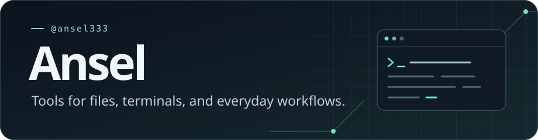

  

## Selected projects

| Project | What it does |
| :--- | :--- |
| [Claude Code Grammar Statusline](https://github.com/ansel333/claude-code-grammar-statusline) | Shows grammar and typo suggestions in the Claude Code status line using LanguageTool. |
| [FileGather Pro](https://github.com/ansel333/FileGather_Pro) | Finds, organizes, and gathers documents across local and network folders. |
| [Point in Polygon](https://github.com/ansel333/CheckPointInPolygon) | Checks whether a point lies inside a polygon with JavaScript. |

## GitHub stats

  
  

  Public data · Updated weekly with <a href="https://github.com/stats-organization/github-readme-stats-action">GitHub Readme Stats</a>

